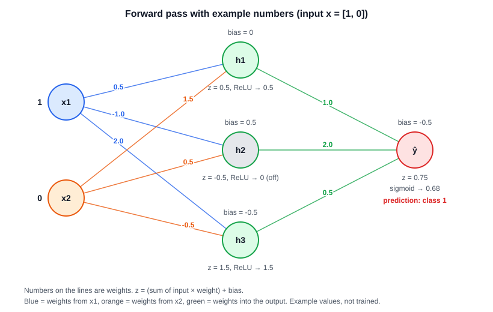

# Neural Network From Scratch using Numpy

A small neural network built with only NumPy. It learns logic gates (AND, OR, XOR).

**Architecture:** 2 inputs → 3 ReLU hidden neurons → 1 sigmoid output, trained with binary cross-entropy and gradient descent.




## Files

- `nn.py`: the forward pass (shared by training and prediction)
- `train.py`: training loop with backpropagation, saves the model to `model.npz`
- `predict.py`: loads `model.npz` and predicts for two numbers you type

## Run

**With uv:**
```bash
uv sync
uv run train.py <gate>      # available gates:  or, and, xor
uv run predict.py
```

**With pip:**
```bash
pip install numpy
python train.py <gate>      # or, and, xor
python predict.py
```
## How it works

1. **Forward:** inputs → hidden layer (ReLU) → output layer (sigmoid) → probability of class 1.
2. **Cost:** binary cross-entropy, averaged over the examples.
3. **Backward:** gradients flow from the output back to the first layer. Each gradient has the same shape as its variable.
4. **Update:** `parameter -= learning_rate * gradient`.

Shapes: 
- `inputs` is (examples, features)
- `W` is (units in, units out)
- `b` is (1, units out).
